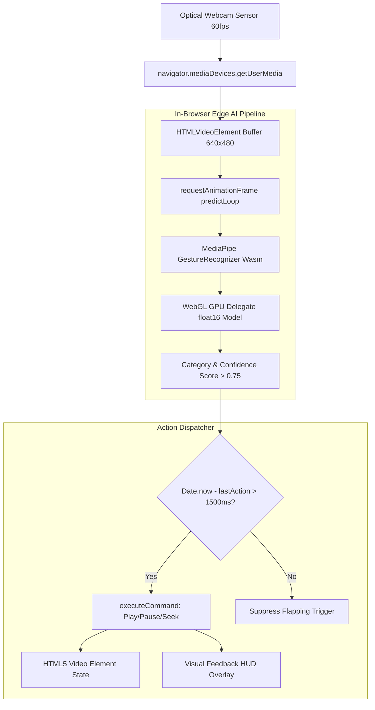

# Full Project Analysis: Touchless Chef Gesture CV

## 0.1 What the Project Is
**Touchless Chef** is an edge-computed, privacy-first computer vision web application designed to solve a universal cooking and workshop dilemma: how to control recipe and tutorial videos when your hands are covered in flour, oil, water, or grease.

Instead of smudging laptop keyboards or phone touchscreens, users simply make natural hand gestures toward their webcam. Google MediaPipe's deep neural network detects hand landmarks and classifies gestures in real-time entirely in-browser via WebAssembly and WebGL GPU acceleration. Recognized gestures immediately execute playback controls (Play, Pause, Fast Forward, Rewind, Step Next) on HTML5 video streams with intelligent time-decay debouncing to prevent accidental triggers.

## 0.2 Real-Time Computer Vision Processing Loop

## 0.3 Inventory Counts
- **Total Frontend Pages/Views**: 1 primary dashboard with modal controls (`App.jsx`)
- **Total Components**: 2 (`ChefVideoPlayer.jsx`, `GestureCore.js`)
- **Custom Services / Managers**: 2 (`GestureManager.js`, `GestureService.js`)
- **Recognized Gestures**: 5 (`Closed_Fist`, `Open_Palm`, `Pointing_Up`, `Thumb_Up`, `Victory`)
- **External Network Dependencies**: 2 CDN assets (MediaPipe Wasm bundle & Google Cloud float16 model task)
