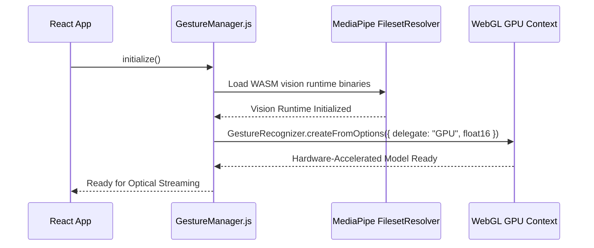

# F1: Client-Side WebAssembly Vision Pipeline & GPU Delegate

## 1. Description & Architecture
`src/services/GestureManager.js` initializes Google's MediaPipe Tasks Vision runtime. It pulls the WebAssembly bundle via `FilesetResolver` and loads the float16 quantized gesture recognition model, configuring it with `delegate: "GPU"` to leverage browser WebGL acceleration.

## 2. Model Initialization Flow

## 3. Say It Out Loud
"I architected the computer vision engine to execute entirely within the client's browser using WebAssembly and WebGL GPU acceleration. By calling MediaPipe's FilesetResolver, the app loads a float16 quantized neural network model into browser memory. Setting the execution delegate to GPU offloads matrix multiplications from the main JavaScript thread to the user's graphics card, maintaining a fluid 30-to-60 frames per second without causing the video player to stutter."
