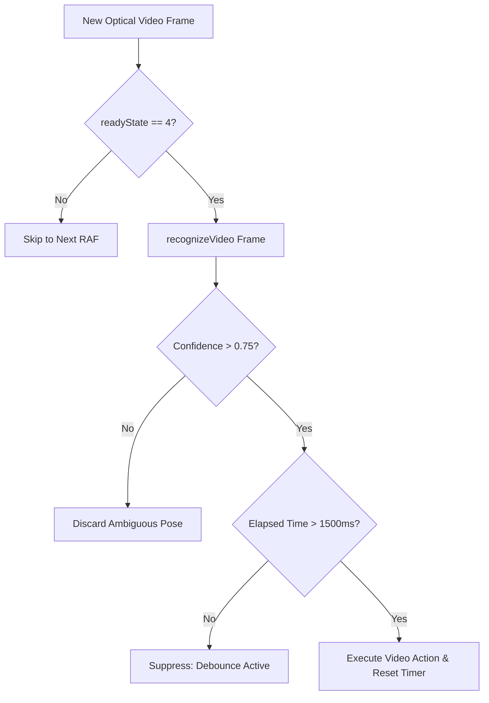

# F2: Real-Time Optical Frame Loop & Debounce Heuristics

## 1. Description & Debounce Logic
Inside `ChefVideoPlayer.jsx`, an active `requestAnimationFrame` loop continuously checks if a new video frame is ready (`readyState === 4`). Detected gestures are filtered through two safety gates:
1. **Confidence Threshold**: $Score > 0.75$ (rejects ambiguous hand poses).
2. **Time-Decay Debounce**: $Date.now() - lastActionTime > 1500ms$ (prevents rapid-fire toggling).

## 2. Heuristic Filter Flow

## 3. Say It Out Loud
"One of the biggest challenges in optical gesture control is preventing accidental double-triggers, known as gesture flapping. I solved this by implementing two distinct heuristic gates. First, any gesture classification with less than 75% confidence is discarded immediately. Second, I introduced a 1500ms time-decay debounce window stored in a React ref. Once a command like Pause fires, the system temporarily suppresses subsequent gesture executions for 1.5 seconds, giving the user ample time to lower their hand naturally without accidentally un-pausing the video."
