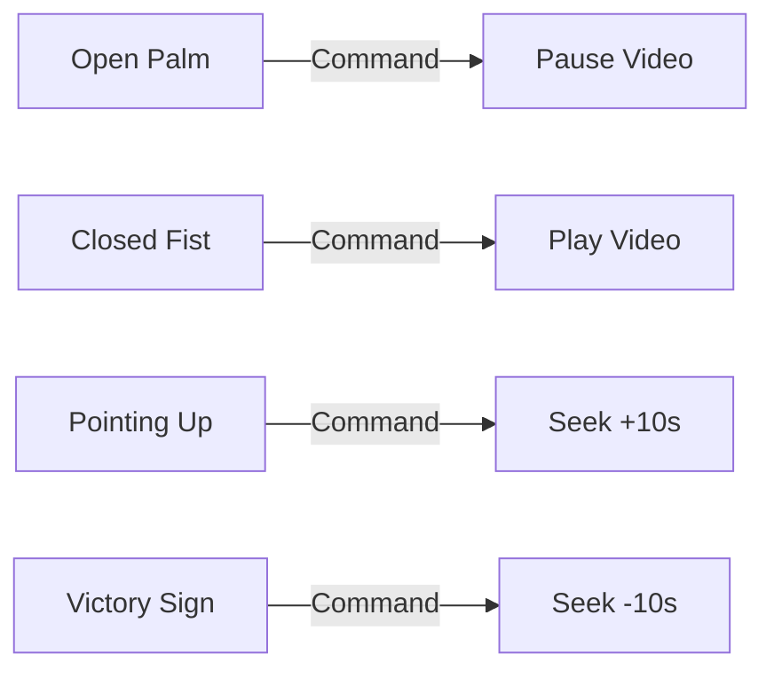

# F3: Touchless Video Playback Engine & Kitchen Gesture Map

## 1. Description & Command Mappings
The system maps recognized biometric gestures to specific HTML5 video actions:
- `Open_Palm`: Pauses playback (`videoRef.current.pause()`).
- `Closed_Fist`: Resumes playback (`videoRef.current.play()`).
- `Pointing_Up`: Jumps forward 10 seconds (`videoRef.current.currentTime += 10`).
- `Victory` (Peace Sign): Jumps backward 10 seconds.
- `Thumb_Up`: Volume up / step complete.

## 2. State Mapping Diagram

## 3. Say It Out Loud
"I designed the gesture vocabulary specifically around natural kitchen movements. An Open Palm acts as an intuitive stop sign to immediately halt the video, while curling fingers into a Closed Fist signals the player to resume. Pointing an index finger forward advances the tutorial by 10 seconds, allowing cooks to quickly re-sync with steps. By directly manipulating the HTML5 video element's DOM properties rather than wrapping third-party players, action execution is instant and deterministic."
