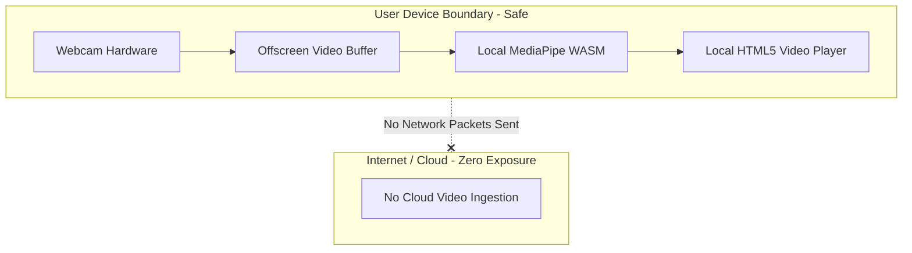

# F4: Privacy-First Zero-Server Camera Architecture & Live HUD

## 1. Description & Security Model
Because the webcam is active in private domestic spaces (kitchens, bedrooms), privacy is paramount. Optical frames are buffered into an offscreen HTML video element and processed strictly in browser volatile RAM. No image data is ever serialized, persisted, or transmitted across the network.

## 2. Privacy Boundary

## 3. Say It Out Loud
"Privacy was the primary architectural consideration for this project. Asking users to turn on a webcam in their home kitchen requires absolute trust. By running the machine learning model entirely in client-side WebAssembly, camera frames never leave the device's volatile memory. The browser does not send a single pixel over the network, completely eliminating the risk of data leaks or server-side interception. Users can even inspect the network tab in DevTools to verify that zero video payloads are transmitted."
